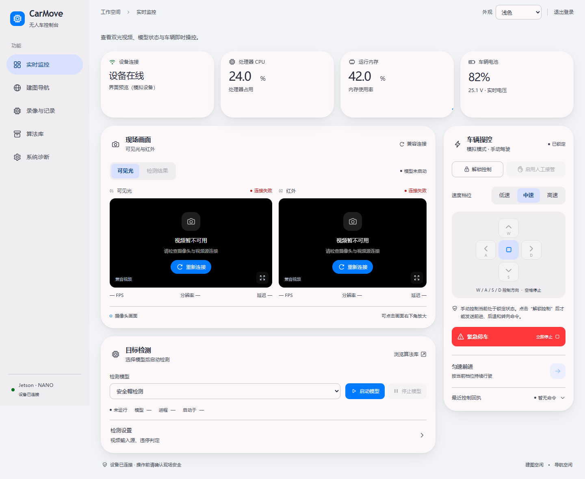
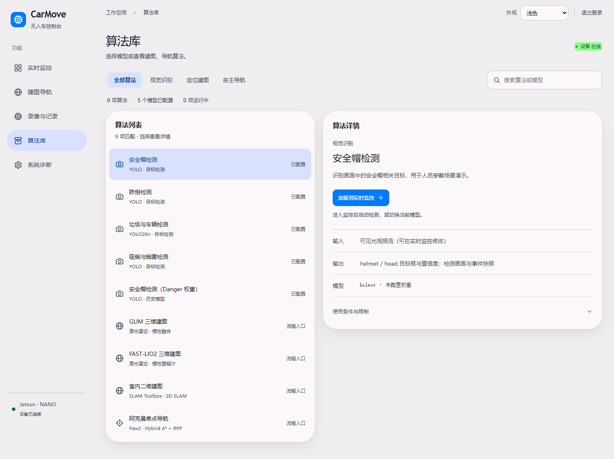
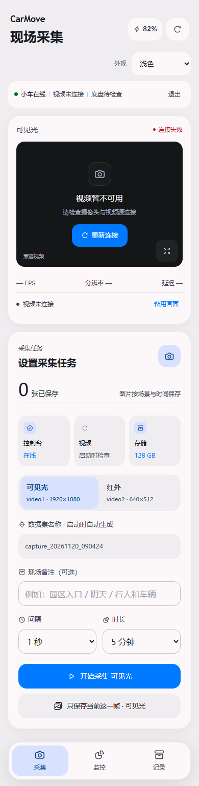
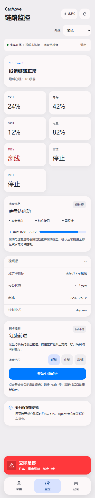
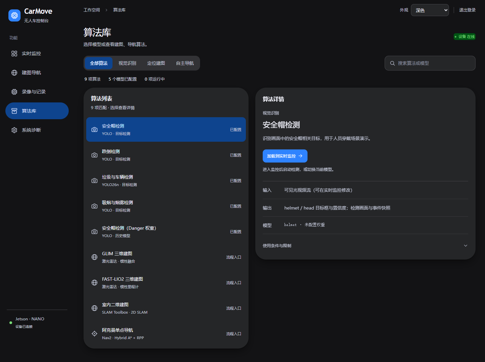
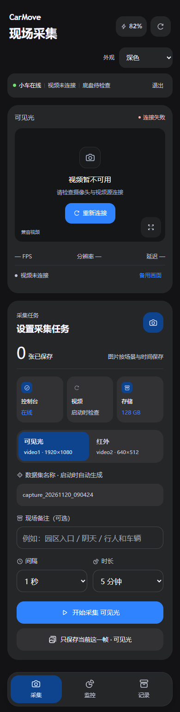
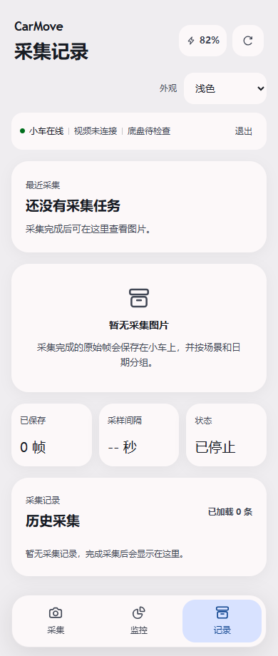
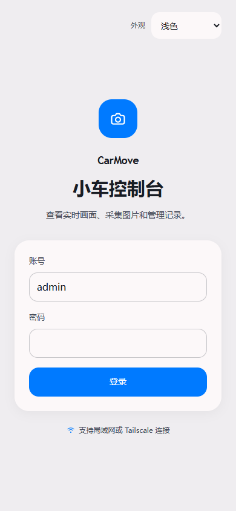

# 智能网联汽车整车技术科创系统

这是板上无人车系统的可维护代码与技术文档整理仓库。项目当前以 Jetson 板上的低速阿克曼无人车为载体，包含：

- apps/nano-deploy：视觉检测、Web Dashboard、Agent/Server、WebRTC、建图/导航工作流与安全控制桥；
- apps/video-recorder：独立的视频/激光雷达录制服务源码；
- ros2/：纳入仓库的 FAST-LIO2、激光雷达/IMU 驱动源码和少量车辆适配包；
- deployment/：板上启动脚本和部署说明；
- tools/：只读 ROS 健康检查、底盘启动前检查和 RTSP 数据采集工具；
- datasets/：垃圾/违停数据集类别定义与本地采集规范；
- docs/：系统盘点、当前状态、设备调试方法和按产品说明书整理的推进路线。

## 最新前端界面

以下为最新前端源码的浏览器实截预览，使用模拟接口数据；未连接实车或摄像头，视频区域保留无画面状态。截图日期、源码版本与视口见 [截图记录](docs/screenshots/manifest.json)。

**实时监控与车辆操控（浅色）**

**算法库**

**手机端（采集 / 监控）**

<table>
<tr>
<td valign="top"></td>
<td valign="top"></td>
</tr>
</table>

查看深色主题、手机记录与登录界面

**算法库（深色）**

**手机端（深色采集 / 采集记录 / 登录）**

前端界面更新后，尽量同步更新以上截图。重建方法见 [截图维护说明](docs/screenshots/README.md)。

## 当前状态

系统已经有稳定演示版 Dashboard，并开始把室内二维链路和室外三维链路分离：

1. 室内保留 slam_toolbox + Nav2，室外新增 XT-16 + Yesense + FAST-LIO2 三维建图；
2. 阿克曼底盘前进左转、前进右转和急停的架空安全验证；
3. 真实模型、视频和传感器链路的可重复测试；
4. 外场完成轨迹、外参和闭环误差测试后，再接入室外障碍投影和全局重定位；
5. 将每次联调结果沉淀为测试记录和版本提交。

完整盘点见 docs/00-system-inventory.md，后续路线见 docs/02-roadmap-from-spec.md。
当前 Sprint 见 docs/05-first-sprint.md。
室外建图与导航路线见 docs/11-outdoor-mapping-navigation.md。

## 安全与仓库边界

首版建议把 GitHub 仓库设为 Private。仓库不会提交 .env、密码/token、模型权重、虚拟环境、录像、原始采集截图、rosbag 或构建产物；模型权重和板上运行数据保留在设备本地。经检查的前端文档展示图仅保存在 `docs/screenshots/`，作为上述排除规则的明确例外。

板上实际运行目录仍是 `/home/nvidia/Desktop/wheeltec_ros2/shijue/Nano_Deploy`。本仓库保存可审查的版本化源码；需要联调时，受控的运行修复会同步到板端目录，但板端的 `.env`、模型权重、运行媒体和构建产物不回写到 GitHub。两边发生改动后，应先做差异核对再继续部署。

## 本地快速查看

    cd /home/nvidia/carmove
    find apps ros2 deployment docs -maxdepth 2 -type f | sort | sed -n '1,160p'

板上运行所需的绝对路径、模型和密钥需要根据设备实际情况配置，不能直接照搬到另一台机器。
